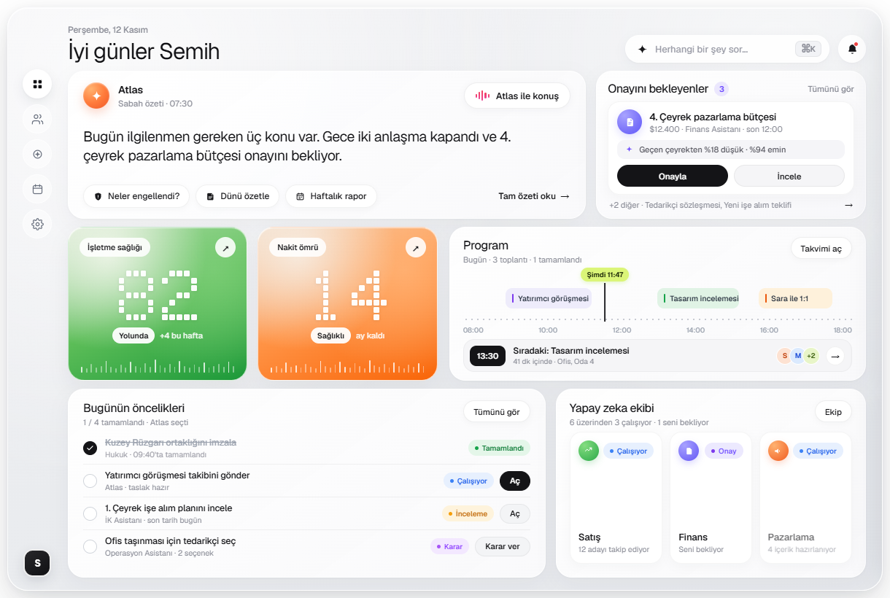
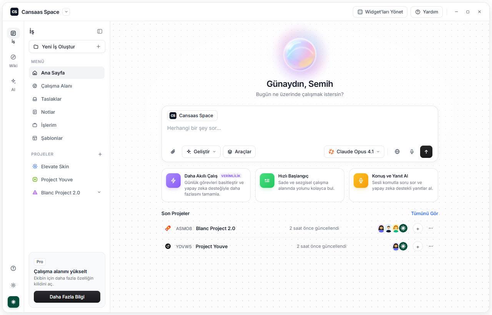
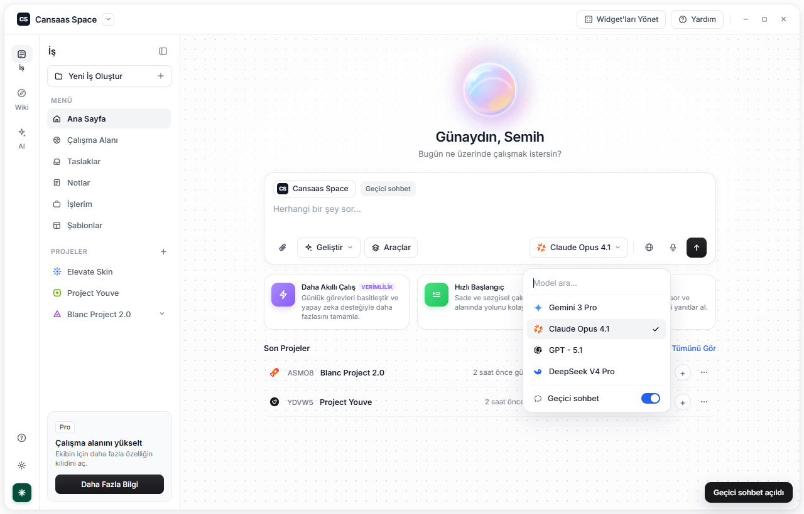

# UI Triad Factory (`ergili-ai-design`)

An autonomous **3-Agent UI Replication & Verification Skill** for Antigravity — designed by **Semih Ergili** (`ergili-ai-design`) to turn reference screenshots, annotated mockups, or UI videos into pixel-faithful, full-functional **Electron** desktop and web applications.

---

## Real Results Showcase (Built with UI Triad Factory)

This repository showcases how the **Analyze → Build → Visual Verify** loop reproduces and blends two distinct desktop interfaces into working Electron applications:

### 1. Executive Bento Dashboard (`İyi günler Semih`) + Cansaas Space AI Workspace

| Executive Bento Dashboard (`İyi günler Semih`) | Cansaas Space — AI Workspace (`Günaydın, Semih`) |
|---|---|
|  |  |

### 2. Interactive Voice Waveform & Multi-Model Popover States

| Live Voice Input Mode | Multi-Model Selector & Temporary Chat |
|---|---|
|  |  |

---

## How the 3-Agent Pipeline Works

```text
Reference Media (Screenshots / Annotated Mockups / Video Keyframes)
   │
   ▼
[Agent 1: ui-analyzer]
   ├─ Inspects every reference frame / marked annotation
   ├─ Splits layout section-by-section (chrome, sidebars, hero, composers, cards, popovers)
   ├─ Extracts exact tokens (colors, dot-matrix grids, radii, typography) & localization widths
   └─ Outputs UI_SPEC.md + 10-Point Verification Checklist
   │
   ▼
[Agent 2: app-builder]
   ├─ Implements modular HTML / CSS / JS + context-isolated Electron IPC
   ├─ Builds live interactions (voice waveform, drag-drop zone, model search, local persistence)
   └─ Passes syntax checks (`node -c`) and desktop launch smoke tests
   │
   ▼
[Agent 3: visual-verifier]
   ├─ Runs isolated E2E click/drag/typing assertions in a real BrowserWindow
   ├─ Captures live state PNGs (default, voice bar, attach menu, dropzone, model popover)
   └─ Scores visual parity side-by-side against references (`0-100`)
   │
   ├── Any section < 95/100 or layout bug? ──► Pixel-exact fix deltas to Agent 2 ──► Re-Verify
   └── Zero runtime errors & ≥ 95/100 visual parity ──► Final Verification & Launch
```

---

## Installation

Install under your global Antigravity skills folder (`ergili-ai-design`) or inside any project's `.agents/skills/` directory:

### Global Installation (Recommended)
- **Windows**: `%USERPROFILE%\.gemini\config\skills\ergili-ai-design\`
- **macOS / Linux**: `~/.gemini/config/skills/ergili-ai-design/`

### Project Workspace Installation
```text
<your-repo>/
└── .agents/
    └── skills/
        └── ergili-ai-design/
            ├── SKILL.md
            └── references/
                └── agent-prompts.md
```

---

## Repository Contents

- [`SKILL.md`](./SKILL.md) — Core skill manifest (`name: ergili-ai-design`) defining the 4-phase orchestration and 1:1 visual parity enforcement loop.
- [`references/agent-prompts.md`](./references/agent-prompts.md) — Prompt templates for `ui-analyzer`, `app-builder`, `visual-verifier`, plus `ffmpeg` keyframe extraction commands.
- [`assets/`](./assets/) — Verified Electron screenshots from both built UI systems (`atlas-dashboard-copy` and `cansaasspace`).
- [`LICENSE`](./LICENSE) — MIT License (`Copyright (c) 2026 Semih Ergili`).
