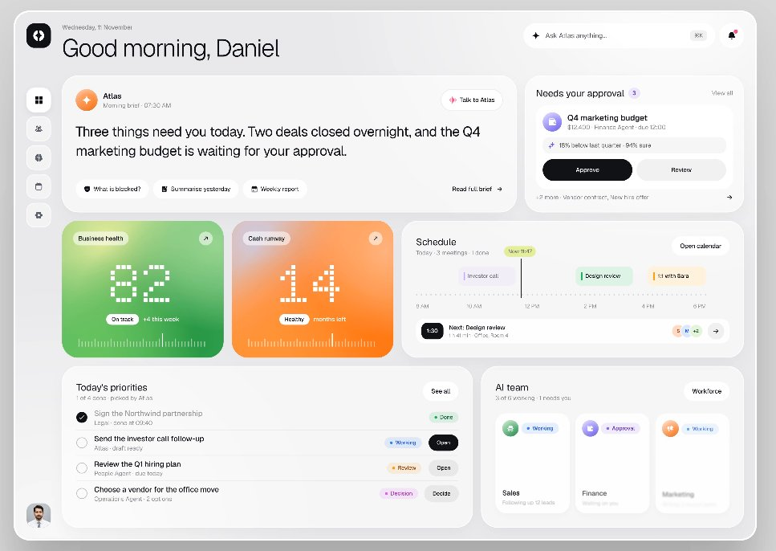
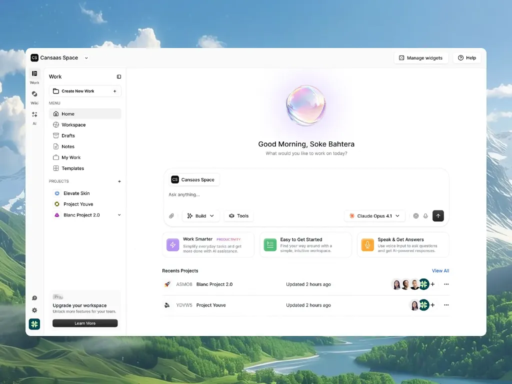
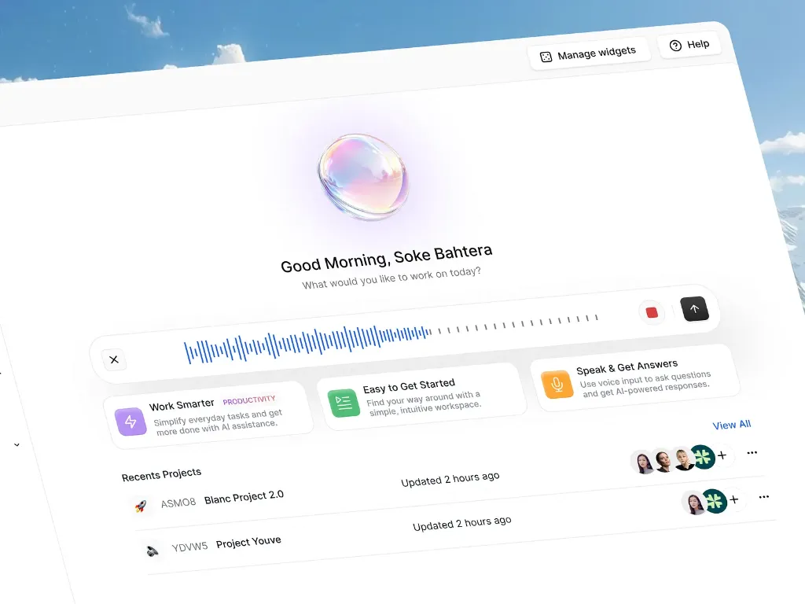
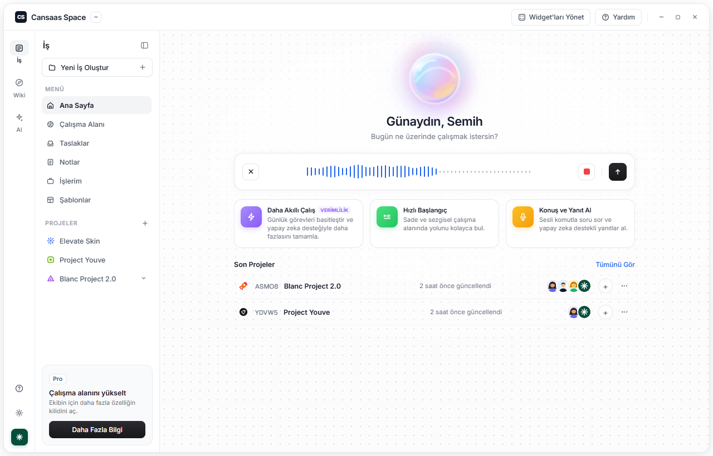
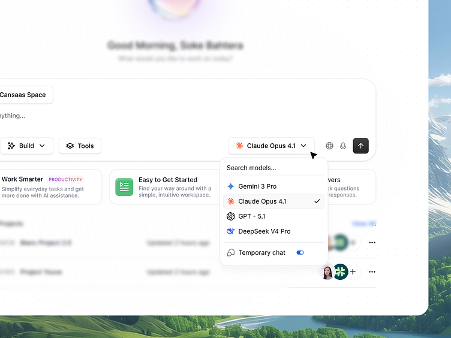

# UI Triad Factory (`ergili-ai-design`)

An autonomous **3-Agent UI Replication & Verification Skill** for Antigravity — created by **Semih Ergili** (`ergili-ai-design`) to convert reference UI screenshots, annotated mockups, or screen-recording videos into pixel-faithful, interactive **Electron** desktop and web applications.

---

## Reference Input vs. Live Electron Output

Each comparison below pairs the **original reference mockup** provided as input on the left with the **live rendered Electron application** autonomously analyzed, built, localized to Turkish, and verified (`96/100` parity) by the 3-agent loop on the right.

### Case Study 1 — Executive Bento Dashboard ([`atlas-dashboard-copy`](https://github.com/semihergili/atlas-dashboard-copy))

| Reference Mockup (Input) | Live Electron Output (Built by UI Triad Factory) |
|---|---|
|  |  |

### Case Study 2 — Cansaas Space AI & Voice Workspace ([`cansaasspace`](https://github.com/semihergili/cansaasspace))

| Reference Mockup (Input) | Live Electron Output (Built by UI Triad Factory) |
|---|---|
|  |  |
|  |  |
|  |  |

---

## Video Motion Comparison (Remotion Showcase)

Full 22-second (`60fps`, `4:3`) UI motion replication — matching every camera pan/zoom, cursor trajectory, hover tooltip, slide-over drawer, and approval toast on the localized **`İyi günler Semih`** dashboard, paired with **custom-synthesized scene-locked stereo audio** (`48kHz`).

| İlk Hali (Reference Video) | Bizim Yaptığımız Hali (Custom Remotion + Audio Output) |
|---|---|
| [▶️ Watch Original Reference (`video_reference.mp4`)](./assets/video_reference.mp4) (`16.78 MB`) | [▶️ Watch Turkish Remotion Output (`video_output.mp4`)](./assets/video_output.mp4) (`11.21 MB`) |

<details>
<summary>Direct Inline Video Previews (GitHub Native Player)</summary>

https://github.com/semihergili/UI-Triad-Factory/raw/main/assets/video_reference.mp4

https://github.com/semihergili/UI-Triad-Factory/raw/main/assets/video_output.mp4

</details>

---

## How the 3-Agent Pipeline Works

```text
Reference Media (Screenshots / Annotated Mockups / Video Keyframes)
   │
   ▼
[Agent 1: ui-analyzer]
   ├─ Inspects every reference frame / marked annotation
   ├─ Splits layout section-by-section (chrome, sidebars, hero, composers, cards, popovers)
   ├─ Extracts exact tokens (colors, dot-matrix grids, radii, typography) & localization widths
   └─ Outputs UI_SPEC.md + 10-Point Verification Checklist
   │
   ▼
[Agent 2: app-builder]
   ├─ Implements modular HTML / CSS / JS + context-isolated Electron IPC
   ├─ Builds live interactions (voice waveform, drag-drop zone, model search, local persistence)
   └─ Passes syntax checks (`node -c`) and desktop launch smoke tests
   │
   ▼
[Agent 3: visual-verifier]
   ├─ Runs isolated E2E click/drag/typing assertions in a real BrowserWindow
   ├─ Captures live state PNGs (default, voice bar, attach menu, dropzone, model popover)
   └─ Scores visual parity side-by-side against references (`0-100`)
   │
   ├── Any section < 95/100 or layout bug? ──► Pixel-exact fix deltas to Agent 2 ──► Re-Verify
   └── Zero runtime errors & ≥ 95/100 visual parity ──► Final Verification & Launch
```

---

## Installation

Install the [`skills/ergili-ai-design`](./skills/ergili-ai-design) folder under your global Antigravity skills directory or inside a project's `.agents/skills/` folder:

### Global Installation (Recommended)
- **Windows**: `%USERPROFILE%\.gemini\config\skills\ergili-ai-design\`
- **macOS / Linux**: `~/.gemini/config/skills/ergili-ai-design/`

### Project Workspace Installation
```text
<your-repo>/
└── .agents/
    └── skills/
        └── ergili-ai-design/
            ├── SKILL.md
            └── references/
                └── agent-prompts.md
```

---

## Repository Structure

```text
UI-Triad-Factory/
├── assets/                          # Before & after screenshots + Remotion video demos (video_reference.mp4 & video_output.mp4)
├── skills/
│   └── ergili-ai-design/
│       ├── SKILL.md                 # Core skill manifest (name: ergili-ai-design)
│       └── references/
│           └── agent-prompts.md     # 3-agent prompt templates & ffmpeg keyframe extraction
├── .gitignore
├── LICENSE                          # MIT License (Copyright (c) 2026 Semih Ergili)
└── README.md
```
